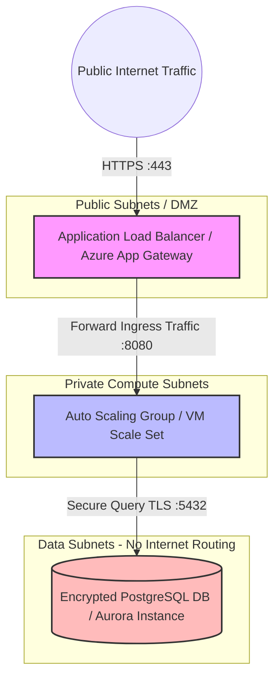

# Multi-Region Enterprise Multi-Cloud Infrastructure Base

A production-grade, highly secure AWS & Azure infrastructure baseline engineered for strict perimeter isolation, compliance-driven data segregation, and secure GitOps deployment validation.

## Target Architecture Blueprint

## Architectural Features
* **Multi-Cloud Parity:** Complete structural definitions mapped cleanly across both Amazon Web Services (AWS) and Microsoft Azure environments.
* **Perimeter Network Isolation:** Public entry points are strictly gated via Load Balancers. Compute nodes run inside private routing zones with no assigned public IP addresses.
* **Zero-Trust Secrets Handling:** Leverages OpenID Connect (OIDC) identity federations inside GitHub Action scripts, fully deprecating long-lived IAM access keys.
* **Compliant Data At-Rest Architecture:** Databases are cordoned into a third, isolated subnet tier completely devoid of default routing paths to the internet, enforcing strict encryption patterns.